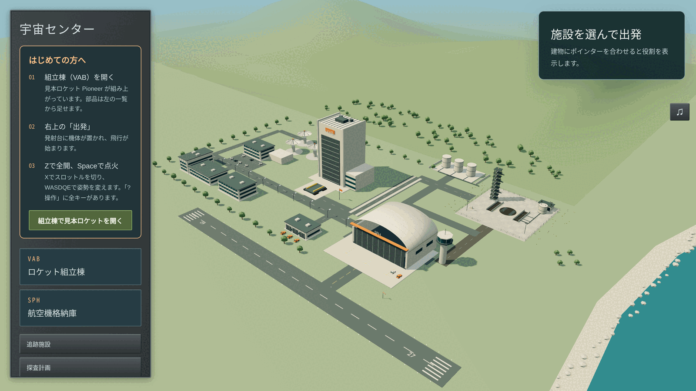
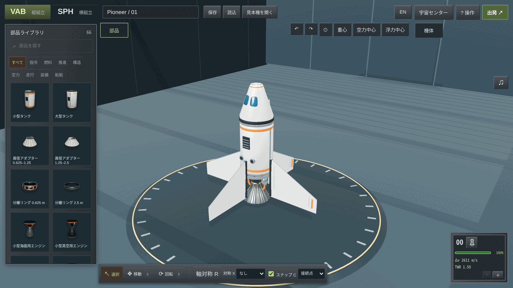
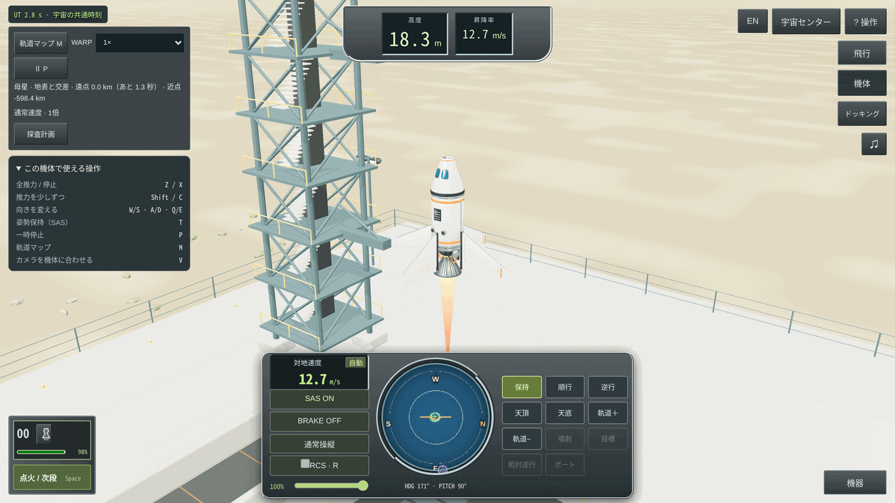

# Nemonaut

Nemonaut is a browser game in which you assemble vehicles from parts — rockets, aircraft, rovers, boats and submarines — and operate them in one persistent world that reaches from the sea floor to the Moon. Rendering uses three.js; the physics is a Rust engine built on Rapier and compiled to WebAssembly; the game logic is TypeScript. Everything runs in the browser and saves stay in the browser's local storage; the site counts anonymous usage statistics (see 利用状況の計測 below, off with `?metrics=off`). The interface is written in Japanese and has a complete English translation. The rest of this document is in Japanese.

**遊ぶ：<https://nemonaut.toming.app>**



## 何であるか

部品を組み合わせて乗り物を作り、同じ世界の中で動かすブラウザゲームです。ロケット、航空機、ローバー、船、潜水艦を、共通の部品と共通の物理で扱います。母星は自転し、月がその周りを回ります。出発した機体は世界に残り、別の機体を出して会合・ドッキングできます。

描画はthree.js、物理はRust（Rapier）をWebAssemblyへコンパイルしたエンジン、ゲーム本体はTypeScriptです。ゲームはすべてブラウザの中で動き、保存はブラウザのlocalStorageに置かれます。サーバー側にあるのは、静的ファイルの配信と、匿名の利用統計を受け取る小さな窓口1つだけです（[利用状況の計測](#利用状況の計測)）。表示言語は日本語と英語で、右上の「EN」/「JA」ボタンで切り替えます（初回はブラウザの言語設定に従います）。

| 組立棟 | 飛行 |
|---|---|
|  |  |

## 遊び方

1. 起動すると宇宙センターが表示されます。「VAB ロケット組立棟」または「SPH 航空機格納庫」を選んで組立棟に入ります。追跡施設からは、世界に残っている機体の観察・操縦再開・回収ができます。
2. 組立棟には見本ロケットが置かれています。左の部品ライブラリから部品を選び、機体の取付位置をクリックして足します。「見本機を開く」から完成済みの機体も選べます。
3. 右上の「出発」で機体が出発地点に置かれ、飛行が始まります。`Z` で全推力、`Space` で点火します。
4. 飛行中は左の「この機体で使える操作」に、いま操縦している機体の部品から決まる操作だけが表示されます。全キーは右上の「? 操作」にあります。

計器の配置と段（ステージ）の並びは、Kerbal Space Programの慣例に沿っています。

### キーボードとマウス：組立棟

| 操作 | 内容 |
|---|---|
| クリック | 部品を選ぶ。部品カードを選んだあとは取付位置をクリックして置く |
| 右ドラッグ / ホイール | 視点を回す / 拡大縮小 |
| 中ドラッグ | 視点を平行移動 |
| 部品を右クリック | 部品の設定窓 |
| `G` / `E` / `Esc` | 移動 / 回転 / 配置の取消・選択に戻る |
| `X` / `Shift+X` | 対称の数を増やす / 減らす |
| `R` / `C` | 軸対称・鏡面の切替 / スナップの切替 |
| `V` | 対称の中心を切替：機体の中心軸 / 取り付ける親部品の軸 |
| `F` / `Delete` | 機体全体を表示 / 選んだ接続枝を削除 |
| `Ctrl+Z` / `Ctrl+Y` | 元に戻す / やり直す（macOSでは `Cmd+Z` / `Cmd+Shift+Z` または `Cmd+Y`） |
| 矢印キー | 視点を回す |

### キーボードとマウス：飛行

| 操作 | 内容 |
|---|---|
| `Space` | エンジン始動 / 次段 |
| `Z` / `X` | 全推力 / 推力0 |
| `Shift` / `C` | 推力を上げる / 下げる |
| `W/S` · `A/D` · `Q/E` | ピッチ · ヨー · ロール（姿勢制御・操舵面） |
| `W/S` · `A/D` | 動力付きの車輪で前後・操舵（ブレーキは自動で解除） |
| `T` | SAS（姿勢保持） |
| `R` | RCSの入 / 切 |
| `I/K` · `J/L` · `U/O` | RCSで平行移動 |
| `B` | ブレーキ |
| `G` | ランディングギアの出し入れ（接地中は格納できない） |
| `F` | フラップを1段展開（3段の次は格納） |
| `H` | パラシュート待機 |
| `CapsLock` | 精密操縦（姿勢操作を25%に） |
| `P` | 一時停止 |
| `M` | 軌道マップ |
| `V` | カメラを機体に合わせる |
| 矢印キー / 右ドラッグ | 視点を回す |
| 部品を右クリック | 部品の操作窓 |
| `F5` / `F9` | 飛行保存 / 飛行復帰 |

時間の進み方は画面のWARPで選びます。2倍・4倍は物理計算を続けたままの加速です。10倍以上は、大気圏外（母星は高度70 km超、月は1 km超）で推力も操作もないときだけ使えます。1000倍・10000倍（高速航行）では全機体の姿勢を固定して軌道を進めます。

### タッチ操作

タッチ端末では画面上のボタンとスティックで操作します。

| 場面 | 操作 | 内容 |
|---|---|---|
| 組立棟 | タップ | 部品を選ぶ |
| 組立棟 | 部品カード → タップ | 取付位置に仮置き。もう一度タップで決定、「取消」でやめる |
| 組立棟 | 1本指ドラッグ / 2本指 | 視点を回す / 拡大縮小・平行移動 |
| 組立棟 | 長押し | 部品の設定窓 |
| 組立棟 | 下のツールバー、↶ / ↷ | 移動・回転・対称（「機体」/「親部品」で対称の中心を切替）・スナップ、元に戻す / やり直す |
| 飛行 | 「姿勢」スティック、↺↻ | ピッチ・ヨー、ロール |
| 飛行 | 「走行」スティック | 動力付きの車輪で前後・操舵 |
| 飛行 | 「次段」「全推力」「推力0」 | エンジン始動 / 次段、推力。細かくは推力のつまみ |
| 飛行 | 「BRAKE」「SAS」「RCS」「FLAP」 | 各装備の切替 |
| 飛行 | 「ギア上げ」「ギア下げ」 | ランディングギア（ギアのある機体だけに出る） |
| 飛行 | 「SAS方向」「RCS並進」 | 順行・逆行などの向き、RCSでの平行移動 |
| 飛行 | 部品を長押し | 部品の操作窓 |
| 飛行 | 画面をドラッグ / 2本指、「⊙」 | 視点を回す / 拡大、カメラを機体に合わせる |
| 飛行 | 「軌道マップ」、「Ⅱ」 | 軌道マップ（ピンチで拡大、ダブルタップで中心へ）、一時停止 |

## シミュレーションの範囲

### 扱っているもの

- **天体**：自転する母星（半径600 km、大気は高度70 kmまで）と、その周りを円軌道で回る月（半径200 km、大気なし）。定数・座標系・積分方法は [CELESTIAL.md](CELESTIAL.md) にあります。
- **大気と空力**：高度ごとの気圧・気温・密度、部品の向きに応じた抗力、翼と操舵面（エルロン・エレベーター・ラダー・フラップ）の揚力と失速。
- **水**：浮力、水の抵抗、フロート、バラストタンクによる潜航と浮上、スクリューと水中での舵。
- **走行と接地**：車輪（駆動・操舵・ブレーキ）、引込式のランディングギア、着陸脚、地面との接触。
- **推進と資源**：海面用・真空用のロケットエンジン、ジェットエンジン、スクリュー。段ごとの燃料、タンク間の燃料移送、ドッキングポートと（設定で入にした）分離リングを越える燃料通過（分離リングの外側にあるタンクから先に消費）、バッテリーと太陽電池（天体の影では発電しない）、リアクションホイールとRCS。
- **熱**：大気圏再突入時の空力加熱、耐熱シールドのアブレーター、過熱による部品の破損。パラシュートによる減速。
- **構造**：段の分離、部品単位の切り離し、過荷重・衝突・過熱による部品の破損と機体の分裂。機体どうしの衝突。ドッキングと再分離。
- **世界と時間**：複数の機体が同じ時刻で進む世界。追跡施設からの操縦切替と回収。時間加速と高速航行。飛行の保存と復帰。
- **軌道の計画**：軌道マップ、マニューバノード、月への接近予測、ランデブーの遷移計画、月遷移・月周回投入・月からの帰還の計画。
- **自動操縦**：軌道への自動投入、マニューバノードの自動噴射、航空機の自動離陸・巡航・滑走路への帰投・自動着陸、RCSによる自動ドッキング。いずれも開始条件を満たした機体でだけ始まり、手動操作と同じ推力・舵・姿勢制御を使います。
- **宇宙センターと記録**：組立棟（縦組立・横組立）、対称配置（軸対称・鏡面。対称の中心は機体の中心軸か、取り付ける親部品の軸。親部品が対称配置されていれば、その全部に同じ並びで付く）、機体の保存・読込・書き出し、設計の診断（重心・空力中心・浮力中心、部品の干渉、段ごとのΔvと推力重量比）。到達記録、地表への観測機の設置と観測。

部品は66種類あります（指令、燃料、推進、構造、空力、走行、装備、船舶の8分類）。

### 扱っていないもの、近似しているもの

- **地形はありません。** 母星も月も半径一定の球面です。地表の模様は描画だけで、起伏は物理に現れません。
- **海は1か所です。** 発射場の南にある半径10 kmの円形の海だけが水面で、ほかはすべて陸です。
- **風と天候はありません。** 大気は母星と一緒に剛体として回転し、状態は高度だけで決まります。
- **重力は二体近似です。** 月の重力圏（半径約2,430 km）の内側では月だけ、外側では母星だけの重力を受けます（パッチドコニック）。複数の天体の重力を同時には加えません。太陽は光源と発電の影の判定にだけ使われ、重力源ではありません。
- **月は単純化しています。** 軌道は母星の赤道面上の円で、月自身は自転しません。
- **機体は1つの剛体です。** 部品どうしの接合のたわみや振動は扱いません。壊れた部品は切り離されて別の機体になります。
- **物理の時間刻みは1/120秒です。** 接触計算は機体近傍の局所座標で単精度、軌道上の位置と速度は倍精度です。
- **時間加速には条件があります。** 10倍以上は大気圏外・無推力のときだけで、高速航行中は姿勢が固定され、SASとRCSは止まります。
- **軌道の予測は真空中の予測です。** 月への接近予測は大気か地表に達した時点で打ち切り、空気抵抗や接地は予測しません。
- **乗員は扱いません。** 有人の指令部品はありますが、乗員の搭乗・船外活動・生命維持はありません。
- **保存はそのブラウザの中だけです。** 別のブラウザや端末とは共有されません。機体の設計はJSONとして書き出し・読込できます。

## 構成

```
src/            ゲーム本体（TypeScript、1ファイル1モジュール）と静的ファイル
  engine/       コンパイル済みの物理エンジン orbital_engine.wasm
  i18n/en.json  英語辞書（キーは日本語の原文）
  assets/       部品と施設の3Dモデル（GLB）
  vendor/       three.js の同梱コピー
engine/         物理エンジンのRustソース
assets-source/  3Dモデルを生成するBlender用Pythonスクリプトと .blend
worker/         匿名の利用統計を受け取るCloudflare Worker（POST /metric）
tests/          node:test による試験と tests/golden の基準データ
tools/          ビルド、検査、試験用の参照実装、飛行実験
```

- **ビルド**：`tools/build.mjs` が `src/` を `dist/` へ変換します。`.ts` は1ファイルずつ型を取り除いて同名の `.js` にし（バンドルしない）、それ以外はそのままコピーします。例外は2つのWorker（離陸予測と着陸計画）で、Workerの中ではページのimport mapが効かないため、それぞれを1ファイルにバンドルします。`dist/` は生成物で、リポジトリには含めません。
- **物理**：ゲームは `src/physics.ts` を通して物理エンジンを使います。これはRapierのJavaScript APIのうちゲームが使う部分を同じ名前で提供する薄い層で、状態はすべてRust側にあります。エンジンのソースは `engine/`、ビルドは `tools/build-engine.sh` で、その成果物 `src/engine/orbital_engine.wasm` をコミットしています。CIは同じスクリプトでビルドし直し、コミット済みのファイルとバイト単位で一致することを確かめます。詳しくは [engine/README.md](engine/README.md)。
- **表示言語**：画面の文言はコード中に日本語で書かれています。英語を選ぶと、`src/i18n.ts` が `src/i18n/en.json` を使って表示を置き換えます。辞書の過不足は試験で検査します。
- **保存**：localStorageの `nemonaut-` で始まるキーに置かれます。
- **3Dモデル**：`assets-source/` のPythonスクリプトをBlenderで実行して生成したGLBを `src/assets/` に置いています。
- **利用統計**：`src/metrics.ts` が出来事をまとめて同じオリジンの `POST /metric` へ送り、`worker/` のWorkerが検査してWorkers Analytics Engineへ書きます。ビルドは、ビルド元のコミットを `dist/build-id.js` に書き出します（統計の行に付く版の印）。

## 利用状況の計測

どの見本機や出発地点が使われ、どこまで進めたかを知るために、匿名の利用統計を集めています。

- **記録するもの**：見本機を開いた、出発した、自動操縦を始めた、到達記録が付いた、機体が壊れた、機体JSONを書き出した・読み込んだ、という出来事と、その種類（見本機・出発地点・到達記録などのゲームに組み込まれた識別子）、部品数、画面を表示していた秒数などの数値。あわせて、端末の種類（タッチかどうか）、表示言語、ブラウザの言語設定、参照元のホスト名、国（サーバーがリクエストから付けます）。
- **記録しないもの**：アカウントはなく、Cookieも使いません。IPアドレスは保存しません。機体名など、入力した文字は一切送りません。機体の設計や保存データも送りません。
- **訪問者の区別**：同じ人の再訪と別の人を数え分けるために、乱数の識別子を1つ、ブラウザのlocalStorage（`nemonaut-visitor`）に置きます。
- **止め方**：`https://nemonaut.toming.app/?metrics=off` を一度開くと、そのブラウザからは以後何も送りません。`?metrics=public` で元に戻ります。

出来事の一覧、保存する列、読み方は [docs/metrics.md](docs/metrics.md) にあります。これとは別に、ページの閲覧数はCloudflare Web Analyticsで数えています（Cookieを使わない集計で、配信側で自動的に挿入されます）。

## 開発

必要なもの：Node.js 24以上。物理エンジンを変更する場合だけRustも必要です（[engine/README.md](engine/README.md)）。

```sh
npm ci              # 依存の導入
npm run dev         # dist をビルドして配信。src の変更で再ビルドする（URLは起動時に表示）
npm run build       # src → dist
npm run typecheck   # 型と構造の検査
npm test            # dist をビルドしてから全試験を実行
node --test tests/planet.test.mjs   # 試験ファイルを1つだけ実行（先に npm run build）
npm run format      # Prettierで整形
```

`npm run typecheck` は次の5つを順に実行します。

1. `tsc`（strict）による型検査（`src/` と `worker/`）
2. `tools/type-hardness.mjs`：明示的な `any` と `@ts-ignore` 類の禁止
3. `tools/type-precision.mjs`：非nullアサーション `!` の禁止と、型アサーション `as` を境界モジュール（`tools/precision.json`）に限ること
4. `tools/module-graph.mjs`：モジュール間の循環importの禁止と、`app.ts` の大きさの上限
5. Prettierによる整形の確認（`src/**/*.ts`、`worker/*.ts`、`tools/*.mjs`、`tests/*.mjs`）

注意点：

- **開発サーバーと試験を同じ作業ツリーで同時に動かさないでください。** 開発サーバーは起動時と `src/` の変更のたびに `dist/` を消して作り直し、試験は `dist/` を読み込みます。
- `npm run vendor` は `node_modules` のthree.jsを `src/vendor/` へコピーします。three.jsの版を変えたときだけ実行します。
- 英語辞書の過不足は `node tools/i18n-extract.mjs` で確認できます（先に `npm run build`）。

## 試験

`npm test` は `tests/*.test.mjs` をすべて実行します。試験はビルド済みの `dist/` を読み込み、ブラウザなしでNode.js上で動きます。物理エンジンは配信物と同じWasmを使います。

- **基準再生**（`tests/golden/`）：固定の初期状態と操作列を再生し、記録済みの結果と許容幅の中で一致することを確かめます。内容は [tests/golden/README.md](tests/golden/README.md)。
- **参照実装との照合**（`tools/golden/*-reference.mjs` など）：翼・抗力・熱・軌道積分について、エンジンとは別に書いたJavaScriptの計算と結果を比べます。npmのRapier（`@dimforge/rapier3d-compat`）は開発時の依存で、照合の相手としてだけ使い、配信物には含まれません。
- **飛行実験**（`tools/*-profile.mjs` など）：離陸、着陸、上昇、再突入などを条件を変えて飛ばし、結果を出力するスクリプトです。`npm run build` のあと `node tools/takeoff-profile.mjs` のように実行します。
- **画面の通し確認**：`bash tools/smoke.sh <URL>` はplaywright-cliでブラウザを操作し、宇宙センターから組立・出発・保存復帰までを通します。`node tools/smoke-touch.mjs <URL> [出力先]` はタッチ端末として横向き・縦向きで同じ流れを通します（playwrightライブラリとChromeが必要。ライブラリの場所は環境変数 `PLAYWRIGHT_MODULE` で指定できます）。どちらも配信中のURLを引数に取り、サーバーは起動しません。

CI（`.github/workflows/`）は、pushごとにビルドと `npm run typecheck`、物理エンジンの再ビルドとコミット済みWasmとの一致確認、基準再生を実行します。全試験の実行は手動で起動するワークフローです。

## 配信

`dist/` を静的ファイルとしてCloudflare Workersに置いています。サーバー側のスクリプトは、匿名の利用統計を受け取る `worker/`（`POST /metric`）だけで、それ以外のリクエストはすべて静的ファイルの層が答えます（`wrangler.jsonc`）。
配信は `tools/deploy-cloudflare.sh` で行います。コミット済みの `src/` から `dist/` をビルドし、`worker/` とあわせて送るため、未コミットの変更があると中止します。

## 第三者のソフトウェア

| ソフトウェア | ライセンス | 使い方 |
|---|---|---|
| [three.js](https://threejs.org/) | MIT | 描画。`src/vendor/` に同梱 |
| [Rapier](https://rapier.rs/) | Apache-2.0 | 物理。`engine/` からビルドされ `orbital_engine.wasm` に含まれる |

Wasmに含まれるRustクレートの一覧と各ライセンスは [src/THIRD-PARTY-NOTICES.txt](src/THIRD-PARTY-NOTICES.txt)、ライセンス全文は [src/vendor/THREE-LICENSE.txt](src/vendor/THREE-LICENSE.txt) と [src/engine/RAPIER-LICENSE.txt](src/engine/RAPIER-LICENSE.txt) にあり、配信物にも含まれます。開発時だけ使う依存（TypeScript、esbuild、Prettier、npmのRapierなど）は `package.json` にあります。

母星と月の物理定数と母星の大気の曲線には、Kerbal Space Programの天体の値を使っています（出典は [CELESTIAL.md](CELESTIAL.md)）。

## ライセンス

このリポジトリのソースコードと素材は、読むために公開しています。再利用・改変・再配布の許諾は与えていません。第三者のソフトウェアは、それぞれのライセンスに従います。
